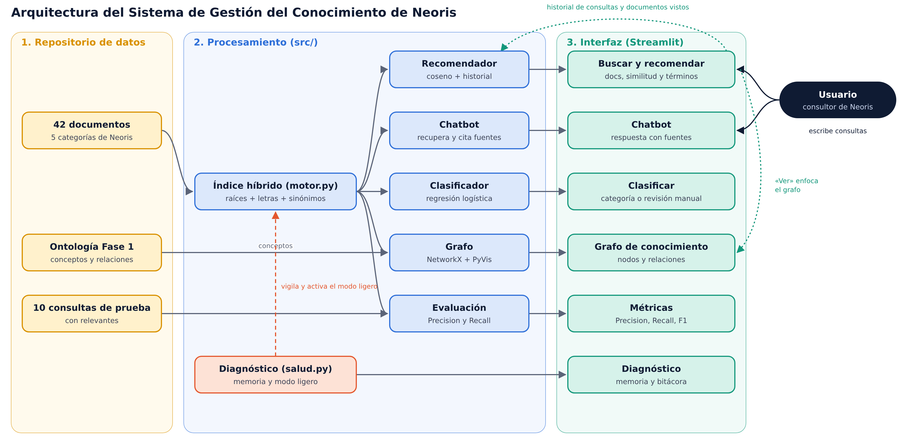

# Sistema de Gestión del Conocimiento con IA - Neoris

Proyecto final de la materia **Sistemas y tecnologías de administración del conocimiento (MAPS)**, Universidad Tecmilenio.

**Equipo:** Vicente Alberto Jahrift Alonso López · Mauricio Flores Frutos · Alan Adelfo Del Angel Figueroa
**Profesor:** Jonathan Alexis Puente Guerrero

**App en línea:** _pega aquí el link de Streamlit Cloud_

Neoris es una consultora de TI que nació en Monterrey (hoy EPAM NEORIS). Los 100 documentos son un escenario de ejemplo hecho para el proyecto, porque la empresa no publica sus documentos internos.

## Qué hace el sistema

| Componente | Qué hace | Archivo |
| --- | --- | --- |
| Clasificación automática | Asigna una de 5 categorías a un documento nuevo. Si la confianza es menor a 45%, lo manda a revisión manual | `src/motor.py` |
| Recomendaciones | Sugiere documentos parecidos (similitud coseno) y documentos según tu historial de consultas | `src/motor.py` |
| Chatbot | Responde preguntas en lenguaje natural con lo que dicen los documentos y cita sus fuentes | `src/chatbot.py` |
| Grafo de conocimiento | Muestra cómo se conectan documentos, categorías y conceptos (amplía la ontología de la Fase 1) | `src/grafo.py` |
| Evaluación | Precision y Recall de búsqueda y clasificación, comparando contra el avance | `src/evaluacion_final.py` |
| Diagnóstico | Mide la memoria, activa un modo ligero y guarda una bitácora para que el sistema no se caiga | `src/salud.py` |
| Interfaz | Une todo en 6 pestañas | `app.py` |



## Incidentes que atiende

1. **Falta de memoria en el servidor.** Si la memoria pasa del 80% del límite, el sistema entra en modo ligero (búsqueda solo por palabras, chatbot sin modelo de lenguaje y grafo sin animación). Si una operación falla, se registra y se usa una respuesta de respaldo. En la pestaña Diagnóstico se puede liberar memoria o reconstruir el índice.
2. **Consultas mal interpretadas.** La búsqueda reduce las palabras a su raíz ("servidores" = "servidor"), compara pedazos de letras para aguantar faltas de ortografía ("servidr") y usa un diccionario de sinónimos ("hackear" → ataque, "home office" → trabajo remoto, "backup" → respaldo). Se puede extender con embeddings poniendo `NEORIS_EMBEDDINGS=1` e instalando `sentence-transformers`.
3. **Dos temas en una consulta.** Si la consulta trae "y también", "además", ";" o "?", se divide y se busca cada tema por separado.

## Cómo ejecutarlo

Necesitas Python 3.10 o más nuevo.

```bash
pip install -r requirements.txt
streamlit run app.py
```

Se abre en `http://localhost:8501`.

Otros scripts:

```bash
python src/evaluacion_final.py   # métricas finales (genera resultados/evaluacion_final.json y .png)
python src/clasificador.py       # clasificador del avance
python src/busqueda_semantica.py # búsqueda del avance
python src/evaluacion.py         # evaluación de la Actividad 4
```

**Opcional:** si pones una clave en la variable `ANTHROPIC_API_KEY` (y agregas `anthropic` a requirements), el chatbot redacta las respuestas con un modelo de lenguaje usando los mismos documentos. Sin clave funciona igual con respuestas por recuperación.

## Cómo publicarlo en Streamlit Cloud

1. Sube este repositorio a GitHub (público).
2. Entra a [share.streamlit.io](https://share.streamlit.io) con tu cuenta de GitHub.
3. Da clic en **Create app**, luego **Deploy a public app from GitHub**.
4. Elige el repositorio `neoris-gestion-conocimiento`, la rama `main` y el archivo `app.py`.
5. Da clic en **Deploy**. En unos minutos te da un link como `https://neoris-gestion-conocimiento.streamlit.app`.

## Resultados de la evaluación

| Métrica | Avance | Sistema final |
| --- | --- | --- |
| Precision de búsqueda (10 consultas, top 5) | 0.44 | **0.94** |
| Recall de búsqueda | 0.58 | 0.57 |
| F1 de búsqueda | 0.47 | **0.69** |
| Precision de clasificación (validación cruzada 5x5) | 0.92 | 0.92 |
| Recall de clasificación | 0.90 | 0.90 |
| Recomendaciones de la misma categoría | - | 63% |

Todo se midió con los 100 documentos. El corte de resultados (75% del mejor puntaje) se ajustó con `datos/consultas_validacion.json`; las consultas de prueba solo se usan para medir.

## Estructura

```
neoris-gestion-conocimiento/
├── app.py                     interfaz en Streamlit
├── requirements.txt           dependencias
├── src/
│   ├── motor.py               índice, búsqueda, recomendaciones y clasificación
│   ├── chatbot.py             chatbot por recuperación
│   ├── grafo.py               grafo de conocimiento
│   ├── salud.py               diagnóstico y modo ligero
│   ├── evaluacion_final.py    métricas finales
│   ├── utilidades.py          carga de documentos
│   └── clasificador.py, busqueda_semantica.py, evaluacion.py   (fases anteriores)
├── datos/
│   ├── documentos/            100 documentos en 5 categorías (20 por categoría)
│   ├── nuevos/                5 documentos de prueba
│   ├── consultas_prueba.json  10 consultas para medir
│   └── consultas_validacion.json  15 consultas para ajustar el corte
├── resultados/                métricas, gráficas y salidas
└── docs/                      documentos, diagramas, ontología y capturas
```
